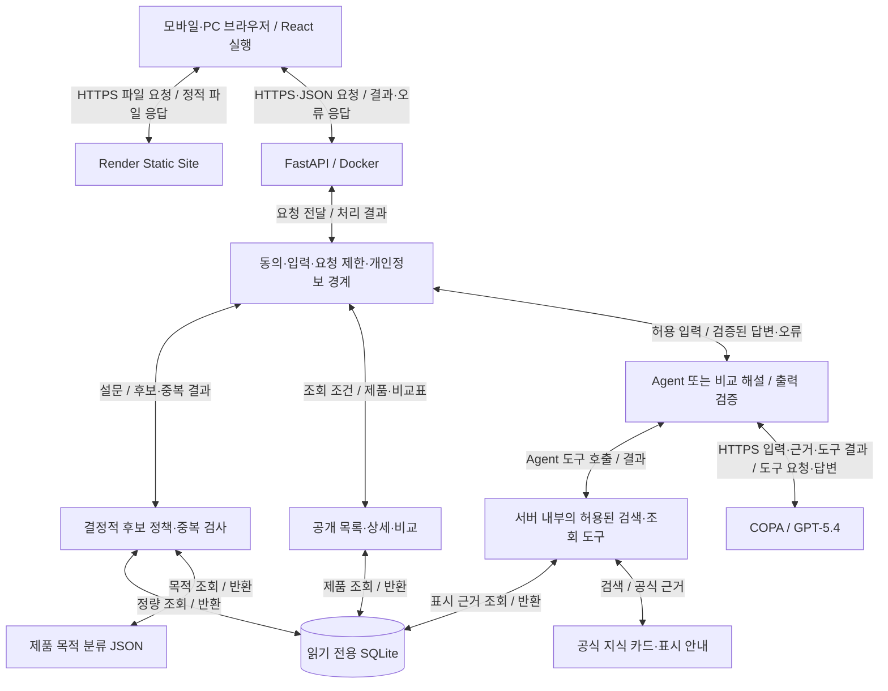

# 시스템 아키텍처

[문서 전체 목차](README.md) · [서비스 소개·실행](../../README.md)

2026-10-24 · 운영 코드 `0bc17dc` · [제출 목차](README.md)

도식 수정: 2026-10-29 · 통신·함수 호출의 요청/결과 반환을 구분했다. 기존 운영 검사 기준일과 코드 기준은 그대로 보존한다.

## 구성과 데이터 경계

양방향 화살표는 **요청 또는 함수 호출과 그 결과 반환**을 뜻하며, 양쪽이 데이터를 수정한다는 뜻은 아니다. 브라우저는 정적 사이트에서 React 파일을 받은 뒤 API 서버에 직접 요청한다. 정적 사이트 서버가 API 요청을 중계하지 않는다. 외부 통신은 HTTPS이고, 서버 내부 모듈·SQLite·JSON 연결은 로컬 함수 호출/파일 조회다. SQLite와 JSON은 운영 중 읽기 전용이다.

그림의 AI 경로는 여러 번 왕복할 수 있다. COPA가 도구 이름·인자를 요청하면 Agent가 허용 목록과 인자를 검사하고 서버 내부 도구를 실행한 뒤 결과를 COPA에 돌려준다. COPA가 DB에 직접 연결하지 않는다. 최종 생성 답변의 스키마·출처·제품·수치는 서버에서 검증하고 화면에 응답한다. 비교 해설은 도구 선택 루프를 사용하지 않는 고정 생성 경로다. 일반 목록·상세·비교표 응답은 AI를 거치지 않는다.

자료 구축의 **수집 → 원문 대조·검수 → SQLite·JSON 생성 → 배포**와 아래의 단계별 실행 흐름은 작업 순서를 뜻하므로 단방향으로 유지한다. 이 자료 구축은 운영 서버의 제품 데이터 쓰기 경로가 아니다.

### 연결별 요청과 반환

| 연결 | 요청·호출 | 응답·결과 | 코드 |
|---|---|---|---|
| 브라우저 ↔ FastAPI | 동의·설문·질문·조회 조건 | 세션·추천·제품·답변 또는 오류 | [services.ts](../../frontend/src/services.ts), [main.py](../../backend/main.py) |
| 서버 ↔ SQLite | 공개 검수 뷰의 제품·표시·정량 조회 | 조회한 행·근거 | [repository.py](../../backend/repository.py), `mode=ro` |
| Agent ↔ 내부 도구 | 허용된 도구 이름·검증한 인자 | 제품·근거·정책 결과 | [agent.py](../../backend/agent.py), `execute` |
| 서버 ↔ 공식 자료 JSON | 지식 질의·표시 주제·제품 목적 조회 | 지식 카드·표시 안내·분류 결과 | [knowledge.py](../../backend/knowledge.py), [label_guide.py](../../backend/label_guide.py), [classification.py](../../backend/classification.py) |
| Agent·비교 해설 ↔ COPA | 최소화한 입력·검색 근거·도구 실행 결과 | 도구 호출 요청 또는 생성 답변 | [copa.py](../../backend/copa.py), [comparison.py](../../backend/comparison.py) |

| 영역 | 보관/처리 | 경계 |
|---|---|---|
| React 화면 | 설문·대화·선택 제품·임시 토큰을 메모리에 유지 | 새로고침·철회로 입력 초기화. 비밀키 없음 |
| FastAPI | 요청 검증, 임시 토큰/만료·요청 시각, 정책/검색/AI 검증 | 건강 입력·대화 원문을 DB에 영구 저장하지 않음 |
| SQLite | 공개 상품·가격·원본·표시·성분·검수·사진 메타데이터 | 사용자 프로필 저장소가 아님. 런타임은 읽기 전용 |
| 분류·지식 JSON | 검토한 상품별 목적 연결, 공식 지식 카드 | Git으로 버전 관리. 사용자를 학습하지 않음 |
| COPA·모델 제공자 | 허용된 질문/이력·최소 설문 조건·검색 근거 | 외부 처리자. 서비스 서버의 삭제 정책과 별개 |

## 주요 실행 흐름

1. **목록·상세·비교:** 화면 → 공개 API → 검수 뷰 → 실제 표시 응답. 보류/없는 제품은404. 공개 비교표에는 동의 토큰을 요구하지 않는다.
2. **추천:** 동의·설문 검증 → 주의/정보 부족 게이트 → 등록 제품 중복 → 목적 분류·표시·예산·제형 필터 → 최대3개 후보 → Agent 검색·이유 설명 → 검증 후 표시. AI 오류가 나도 후보 정책 결과와 오류를 분리해 응답한다.
3. **대화:** 동의 → 질문 분류·민감 입력 경계 → 필요 시 설문 정책 → 모델의 도구 선택 → 제품/지식 RAG → 최종 답변 검증. 개인 판단·위험 상황 질문은 로컬 안내 경로로 처리한다.
4. **AI 비교 해설:** 선택 품번2개 → 표시 비교 사실/출처 ID 생성 → 공용 캐시 확인 → GPT 생성·서버 검증. 제품 교체 시 화면은 이전 해설을 숨긴다. 실패해도 공개 표시표는 유지된다.
5. **철회:** UI 입력·대화·임시 토큰 초기화 및 서버 세션 폐기. 이미 외부로 전송한 정보의 삭제를 소급 보장하는 기능은 아니다.

## API 계약과 응답 경로

경로별 입력·인증·응답·오류의 기준은 [기능 요구 명세서 5.2](../functional-requirements.md#52-api)에서 관리한다. 실제 구현은 [main.py](../../backend/main.py)·[models.py](../../backend/models.py), 실행 결과는 [API 원본](evidence/acceptance-api.json)을 확인한다.

공개 목록·상세·표시 비교는 AI를 거치지 않는다. 추천·대화·AI 비교 해설은 동의 세션과 입력 경계를 거친다. 추천의 `ok/restricted/insufficient/empty` 상태와 AI 성공/실패는 별도 필드이며, 서버는 처리 결과 또는 `error.code/message`를 브라우저로 반환한다. 동의 401·입력 422·제품 404·요청 제한 429·외부 AI 장애를 구분한다.

## DB와 원본 추적

DB: [products.sqlite3](../../data/products/products.sqlite3). 주요 관계는 `products` 품번을 중심으로 가격(`prices`), 출처(`sources`), 표시(`product_fields`, `label_blocks`), 성분(`ingredients`, `product_ingredients`, `nutrient_amounts`), 검수(`reviews`, `label_reviews`, `field_review_dates`, `correction_history`), 사진(`product_thumbnails`)이 연결된다.

런타임 [repository.py](../../backend/repository.py)는 `verified_product_fields`, `verified_product_nutrients` **뷰**와 검수 상태를 사용한다. 수집88개 중87개를 공개하고 `600651654`를 제외한다. 옛 수집 단계의 `recommendation_eligible=0` 열을 현재 추천 가능 제품 수로 해석하지 않는다. 현재 후보 분류는 별도 [classification-v2.json](../../data/recommendation/classification-v2.json)의28개 제품·40개 성분/기능 연결과 정책을 사용한다. 공개87개 전체가 자동 추천 후보는 아니다.

원본 URL·이미지·OCR·라벨 블록·수정 이력은 [데이터 문서](../product-database.md)와 [라벨 검수 기록](../product-label-review.md)에 있다. 공식 가격은 관찰한 포장 가격이며 일일 비용·실시간 가격을 의미하지 않는다.

## 배포와 버전 관리

프런트는 Render 정적 배포, 백엔드는 저장소 루트 [Dockerfile](../../Dockerfile)로 Python3.13·잠금 의존성·backend·검수 SQLite·추천 분류를 포함한다. 프런트 썸네일은 정적 파일로 배포한다. 별도 DB 서비스나 영구 디스크는 사용하지 않는다. 새로운 데이터는 로컬에서 검수·재생성한 뒤 코드와 함께 배포한다.

운영 주소는 프런트 `https://vitastep-guide.onrender.com`, API `https://m2-1-api.onrender.com`이다. 프런트 공개 `VITE_API_BASE_URL`과 서버 허용 출처를 맞춘다. 비밀키는 백엔드 환경변수에만 둔다. Render는 `production`을 배포하며 `canary → dev → production` 승격과 CI4개를 사용한다. 별도 시험 서버 없이 canary 로컬 검증을 먼저 한다. 자세한 절차는 [CONTRIBUTING](../../CONTRIBUTING.md)과 [보안·운영](security-and-operations.md)을 따른다.

## 구조의 한계

세션·요청 제한·비교 캐시는 단일 프로세스 메모리 기준이며 서버 재시작 시 사라진다. 여러 인스턴스로 확장할 경우 공유 저장소·전역 제한이 필요하다. 지금은 회원 서비스나 대규모 트래픽을 전제로 하지 않는다. Agent 실행은 기본45초로 제한하고 여러 모델 호출을 그 안에서 수행한다. 서버 기동·연결·정책 처리까지 포함한 전체 UI 대기 시간을45초로 보장하는 것은 아니다. 자동 검사가 모든 자연어·의학적 의미 오류를 검출하지는 못한다.

후속 로컬 성분 카드의 성인 비율은 [공식 기준 JSON](../../frontend/src/data/adult-intake-references.json)과 서버의 검수 정량으로 브라우저에서 계산한다. 기준군 선택은 API 계약에 추가하지 않았으며 외부 모델로 보내지 않는다. 원래 상품의 표시 비율은 별도 원문 값으로 보존한다.
